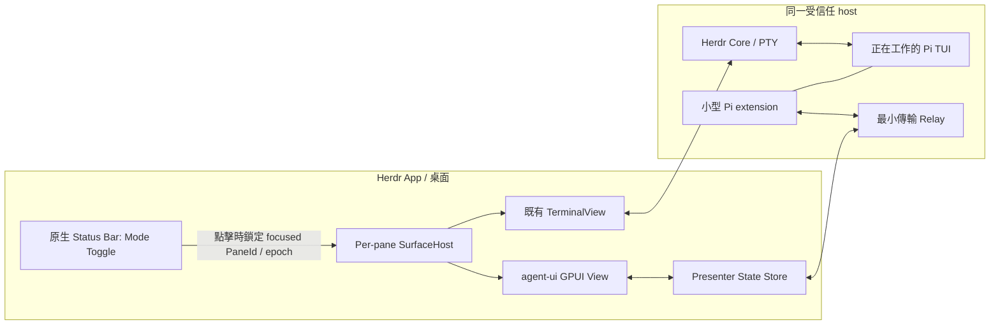

# 03 · UI-first 架構：單一 Pi、雙呈現

本文件定義**欲實作的系統**，不是宣稱 Herdr 已提供所有接口。需求來源見 [總覽](README.md)；上游證據見 [01](01-evidence.md)；互動細節見 [02](02-ux-spec.md)；事件型別見 [04](04-pi-contracts.md)。

## 1. 第一原則：UI 不擁有 Agent



**不新增** Session JSONL Reader、file watcher、index DB、歷史檔案搜尋、Moshi 全功能 gateway。Pi 已經持有對話狀態；本專案讀的是 *同一 Pi runtime 的 extension 所發送的狀態與事件*。

執行所有權與視覺狀態分離：

| 資源 | Owner | 切到另一模式時 |
| --- | --- | --- |
| Pi 程序、tool execution、PTY | Herdr Core／Pi | 原樣繼續，不重啟、不 pause |
| 原生 TerminalView／scrollback／Kitty images | Herdr App | 保留 entity 和 attach；只暫停繪製／輸入路由 |
| Pane 模式與焦點 | Herdr App SurfaceHost | 僅變本 Pane 的 `terminal/ui` 呈現 |
| **Status Bar 切換控制** | Herdr App 的既有 Status Bar renderer／可驗證組合接口 | 由 focused Pane 讀取 mode、啟用能力；按下時捕捉 PaneId 和 epoch，僅發送目標 Pane 的切換請求 |
| Pi 事件與在記憶體的 Session | 同一 Pi instance 的 extension | 持續提供資料；不得因 GUI 消失而阻塞 Pi |
| 可見對話投影／scroll anchor／disclosure／草稿 | Mod／presenter store | 儘可能保留；失效後按同 binding snapshot 恢復 |
| Host 傳輸 | 最小 relay／adapter | 可重連；離線只影響 UI 資料／控制，不影響 Pi |
| 安裝／升級 | 使用者同意的 Installer | 不自動改動正在工作的 Agent |

## 2. 最難的缺口：真正的同一原生 Pane

[Herdr `window.rs`](01-evidence.md#h4) 保留 Tab 中 TerminalView，降低視覺切換成本。**但** [`layout.select`](01-evidence.md#h3) 操作的是 `chrome` layout 的 stack，不能直接推論它能替換任意 split Pane body。

### 候選整合路線

| 路線 | 是否符合最終需求 | 用途 |
| --- | --- | --- |
| 在固定 Layout stack 裡放 Terminal Block／Mod | 只可驗證部分呈現，不證明任意 model Pane | 實驗與視覺原型 |
| 用 Mod Pane 和 Terminal 分離兩欄 | **否**；改變原本 Pane 的幾何 | 不作最終方案 |
| `terminal.park`／`pane.close`／重啟 Pi | **否**；違反不中斷 | 禁止 |
| 最小 Herdr App **per-pane alternate presenter hook** | **可設計**，要驗證或提出上游 PR | 正式首選 |

建議的宿主契約（**提案 API**，不是現在已有的 command）：

```ts
interface PaneSurfaceHost {
  get(paneId: string): { terminalAddress: string; mode: "terminal" | "ui"; epoch: string };
  setMode(paneId: string, mode: "terminal" | "ui", expectedEpoch: string): void;
  // Runtime stays attached. No PTY resize-to-zero; no editor input injection.
}

interface FocusedPaneForStatusBar { // proposed host-owned context
  paneId: string;
  terminalAddress: string;
  epoch: string;
  supported: boolean; // true only for verified Pi pane
}
// Status Bar click captures this target atomically, then calls setMode.
// Do not re-read a different focused() Pane after asynchronous work.
```

**切換入口放在視窗底部的既有 Status Bar，不在 Pane Header。** Status Bar 是視窗級共享 UI，但操作對象是當前 focused Pane。狀態列應隨焦點更新顯示：Pi + Terminal → 可切 UI；Pi + UI → 可切 Terminal；Shell／未綁定／無 active Pane → disabled，不得推測或操作最後一個 Pi。UI 初始化失敗時，宿主仍需提供 Status Bar 回 Terminal。

狀態列整合必須**共用原本 Status Bar renderer 的背景、頂部 border、高度與 spacing**，保留 Machine、Agents、Commands、現有 `project-open` 按鈕等；**不使用獨立 Layout Block 或 32px cut-out**。可能需要統一的 Status Bar 小型 compositing API／slot registry；這是新增的 host 能力提案，不能假設兩個 Mods 互相嵌套已被上游支援。

實作應保留 PaneId、TerminalView 實體、原本的 pane tree／split／zoom／尺寸；只切換 body renderer。切回 Terminal 不是重新 `attach`。宿主擴充不得耦合 Pi API：它只認一個 Mod 呈現者，將來 Codex／Claude 也能使用。

**P0 Gate：** 先取得使用者 Mac 的 App 版本與生成的 API types，再實測三 Pane、100 次切換、工作中輸出、焦點／scrollback／Kitty。沒過關不能標示「原生同 Pane 已完成」。需要 PR 時單獨處理，不在 Mod 安裝器暗中 patch Herdr App。

## 3. UI 模組優先，Bridge 保持最小

建議開發路徑：

```text
mods/agent-ui/
  main.js                 # GPUI root, surface mode & event wiring
  mod.json
  components/
    statusbar-toggle.js   # control host/status bar; targets focused Pane only
    header.js             # Pi / host / status metadata; NO mode switch
    conversation.js       # visible turns and activity groups
    user-message.js
    assistant-message.js
    tool-card.js          # registry + specialized presentations
    composer.js
    status.js
    search.js
  state/
    view-state.js         # per Pane draft, disclosure, scroll anchor, mode
    projection.js         # event -> grouped UI rows
    identity.js           # rejects stale/wrong runtime events
  styles/
    tokens.js             # native theme tokens; CJK/mono/type scale
  fixtures/               # synthetic: mock snapshots, streaming, errors

integrations/pi-agent-ui/
  extension.ts            # same active Pi TUI: events + memory snapshot + controls
  transport.ts            # versioned, bounded, nonblocking messages

host/agent-ui-relay/       # only if needed for desktop/native/SSH transport
  ...                     # small authenticated IPC adapter, NOT history/index server
```

這是**預期目錄**，不是已存在的檔案；能否以多檔 JS 模組被 Herdr Mod Loader 載入，要在 P0 用目標版本驗證，必要時由 build step bundle，不能假設一般 Node runtime 在 Mod 裡。

### 呈現核心

- `StatusBarModeToggle` 由宿主／Status Bar compositor 掌握，與 Agent UI 的 rendering lifecycle 分離；讀 active Pane、mode、capability，原子捕捉 click target，再派發 switch。
- `AgentUiView` 僅做 UI 與調度；不在 `render()` 中呼叫網路／subprocess。
- `ProjectionStore` 使用 immutable event records，將同一使用者意圖整理成 turn；最新 live tail 與已完成 turns 分開更新，避免每 token 重建全部行。
- `ToolRendererRegistry` 根據工具類型投影成 `summary/details`，未知工具用安全純文字 fallback。
- `ViewState` 以 `ViewKey` 綁定草稿、disclosure、scroll anchor、搜尋、模式；不同 Pane 不共用焦點。
- `ThemeTokens` 從 `theme()` 取得背景／文字／border，文字階層、間距、hover/focus/a11y 都一致。
- `State` 是資料，不是動畫：更新 coalesce；原生動畫不用高頻 JS `notify()` 驅動。

## 4. Pi Adapter 只做 GUI 所需事情

Pi 的 [Extension API](01-evidence.md#p2) 能直接在**現有** TUI instance 觀察：

- `session_start` / `session_shutdown`、`ctx.sessionManager.getSessionId()`、`getLeafId()`；
- `ctx.sessionManager.getBranch()`／`getEntries()`：請求時提供**有界的記憶體 snapshot**，不自行尋找或解析 `*.jsonl`；
- `message_start/update/end`、`tool_execution_start/update/end`、settled 狀態：供 live UI；
- 經身份與能力驗證後 `sendUserMessage`、steer／followUp、abort。

### Snapshot + live

UI 首次打開：Pi extension 送入最近有界的、**當前分支**資料視窗，UI 完成 bootstrap。後續由 events 更新。切換回 Terminal 不要求 extension 停止；回來如果 event cursor 過期，就向**同一 runtime**要新的 snapshot。內容超過預算只分頁內存中有的資料，**不開 JSONL 歷史讀取服務**。

Pi 的 `message_end` hook 與 SessionManager append 並非原子事件；不需要為 GUI 等待磁碟寫入。GUI 使用 bridge 自己的穩定 `producerEpoch + eventId + toolCallId` 組合識別；必要時對照當前 Pi 內存快照。不能以文字相同加時間窗強行去重。

**無 extension 時：** Herdr 原有 agent metadata 仍顯示；UI 提示「此 Pi 尚未啟用 GUI 整合」，提供原生 Terminal 切換。這不是另一種 Reader 模式，不啟動第二個 Pi、也不假造聊天歷史。

### Extension 不能影響模型工作

Hook 僅複製必要的小型資料並 enqueue，使用有界 ring／backpressure；傳輸慢則給 `gap` 並允許 snapshot resync，**不阻塞 provider/tool 生命週期**。不返回變更 message 或 tool result 的值、不註冊與本功能無關的工具。不在有工作時強制 `/reload`；安裝 extension 後由使用者在 idle 時啟用，或等下次 Pi 啟動。

## 5. 傳輸：先證實能力，別建造另一個平台

Herdr GPUI Mods 是受限 JS runtime，不是 Node／DOM／WebView。可用 API 以目標機器的 `herdr.d.ts`／`gpui-kit.d.ts` 為準。[H1–H2](01-evidence.md#h1)

- 先在本機用 synthetic event feeder 建 GUI；此階段不需要 host service。
- Pi integration 先做低頻、bounded 的 snapshot/events relay，視已驗證的 `exec`、`fetch` 等能力選通道；不要把 stdout session 協定誤認成任意 WebSocket 可用。
- 多機器使用受信任 Herdr／SSH 路徑，獨立的 host identity + runtime binding；不可直接公開網路 listener。
- 如果 GUI 需要輸入大 prompt，**不得**把內容／token 放在 argv 或 log；採已驗證的 request body → 認證 loopback relay → private stdio/IPC，且要確認 backpressure 與 ACL。
- Relay 可是很薄的 transport adapter；**不負責解析 Pi Session JSONL、索引歷史、掃描家庭目錄**。
- 一個 runtime 可有多位 observer，但命令有每次驗證的 capability／input revision，不能因為共用 Session 就自動允許其他客戶端操作。

## 6. UI 狀態機與失效隔離

```text
Surface: terminal | preparing-ui | ui | ui-error
Transport: disconnected | connecting | live | stale | error
Agent: unknown | working | awaiting-input | settled | interrupted
Control: unavailable | validated | dispatching | uncertain
```

這四軸互不互相推出。傳輸離線不代表 Agent 停止；工具沒有 end 不可畫成功。UI 無 bridge 而仍有 Terminal 能力時，不出現永久 spinner。返回 Terminal 的入口必須由宿主掌握，即使 Mod 當機也可操作。

身份變更（`/new`、resume、fork、Pi 重啟、core 重新指向）產生新的 `bindingEpoch`；所有舊資料回覆、焦點與控制請求在進畫面前檢查。舊草稿封存但不移送另一 Session。Renderer state 是可丟棄的快取，不得成為第二個 transcript authority。

## 7. 優先實作的 native UI

**排程約束**：以下是目標 UI 的功能範圍，不是 P0 一次完成的清單。P0 先以 fixtures 驗證可操作原型與 focused-Pane 切換；P1 依 [07 · 原型後 UI／UX 打磨](07-post-prototype-polish.md) 對實機觀察到的摩擦做第二輪設計，才進入 Pi runtime adapter 整合。

具體畫面、尺寸、長內容、IME 與可訪問性規格集中在 [02](02-ux-spec.md)。首個 UI prototype 需要呈現：

1. **底部 Status Bar**：明確 `Terminal | UI`，綁定目前 focused Pane、模式與可用能力；必須原位嵌入原有 status renderer，保持 Project Open／Commands 顯示。Pane Header 只顯示 Pi／host／工作狀態，不放模式切換。
2. Message timeline：使用者段落、助手答案、當前活動，按使用者 intent 分組。
3. Tool summaries：類型與數量；失敗、未確定與等待輸入始終可辨認。
4. Composer：自動成長、草稿、Shift+Enter 與 IME；未連通時禁用 Send。
5. 搜尋、回底、scroll anchor、Copy、鍵盤 focus、窄版。
6. CJK／Markdown／code／diff／科學公式的來源保真與降級。

## 8. 安裝／相容與不干擾現有 mods

獨立 `mods/agent-ui`，不修改 `project-open`。安裝器繼承專案「個人 Layout／有確認／單一 .bak」原則，但**不在功能未驗證前實作自動改寫 split Pane 樹**。

分成 Mod、Pi extension、可選 relay、可選 Herdr App surface hook 四個可獨立回退的層次。卸載 GUI 不刪 Session、不發 `abort`、不終止 Pi；恢復原生 Terminal 的路徑不依賴 bridge。交付測試見 [05](05-delivery-and-tests.md)。

**本設計不以 JSONL Reader 作前置工作。真正的優先級是切換與 UI 使用體驗。**
